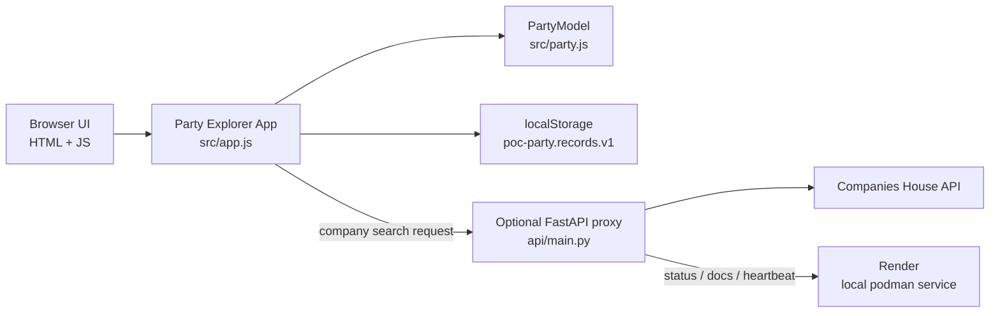
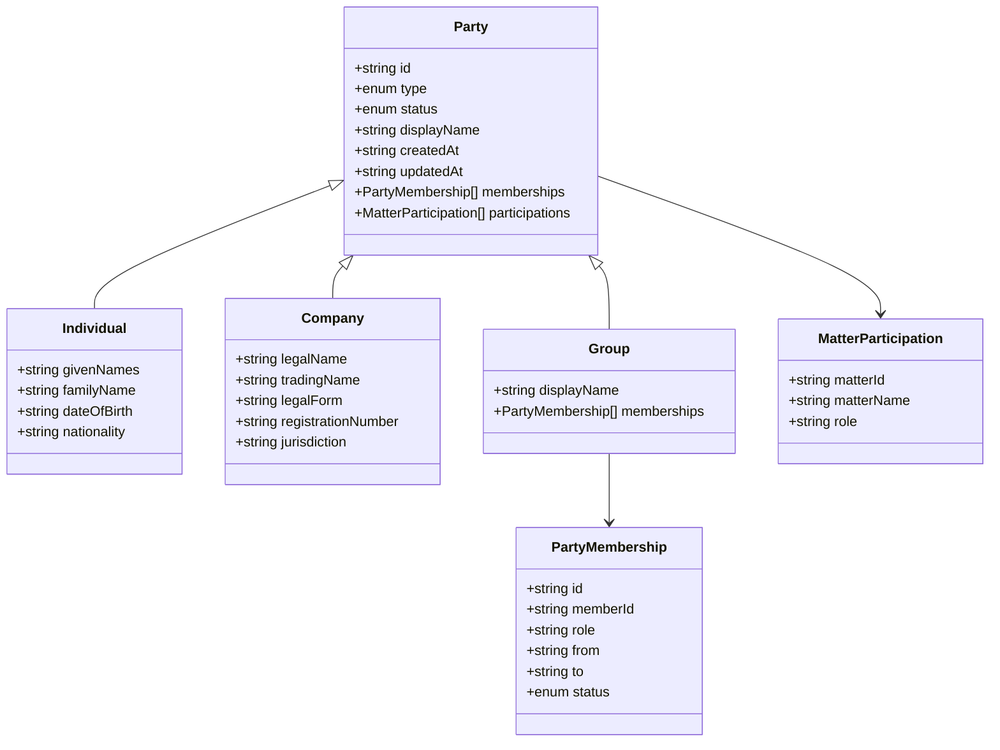
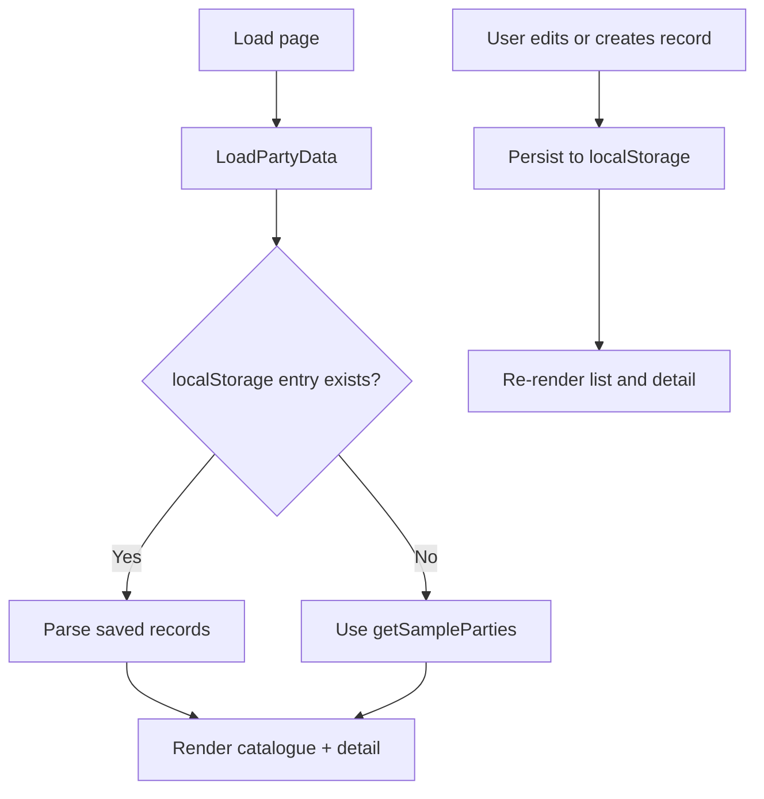
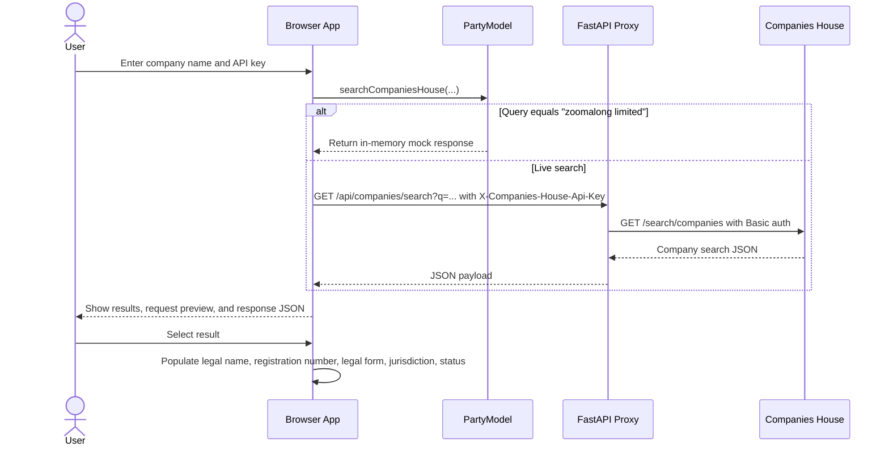
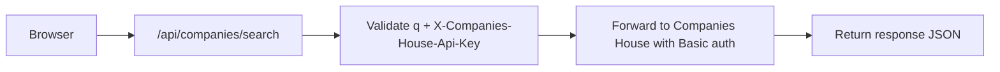

# Party Explorer implementation design

This document describes the current implementation of the Party Explorer proof of
concept, based on the browser app in `src/`, the optional FastAPI proxy in `api/`,
and the local-run script in `scripts/`.

## 1. Purpose and scope

The POC demonstrates a reusable Party model for three Party types:

- Individual
- Company
- Group

It focuses on identity, memberships, and contextual matter references rather than
production-grade identity or compliance controls. The app is intentionally static and
runs in the browser with smoke tests covering validation and search behaviour.

The implementation is a browser-native proof of concept, with an optional service that
proxies Companies House lookups. The design supports local experimentation without
requiring a backend for the main flow.

## 2. Current implementation structure

The current implementation is split into the following layers:

- `src/index.html`: page skeleton and form layout
- `src/documentation.html`: in-app guide published alongside the static client
- `src/documentation.css`: styles for the in-app documentation page
- `src/config.js`: runtime config for the optional Company API service URL
- `src/party.js`: domain model, sample fixtures, validation, and search helpers
- `src/app.js`: render logic, event handling, localStorage persistence, and UI state
- `api/main.py`: FastAPI proxy for Companies House search requests
- `scripts/run-local.ps1`: local containerised startup script for the API and client
- `tests/party.test.cjs`: focused validation and API behavior tests

## 3. Runtime architecture

### Runtime behaviour

`src/index.html` loads the app in this sequence:

1. `config.js` sets `window.PARTY_API_BASE_URL` if the local proxy is configured.
2. `party.js` defines the Party model and sample data.
3. `app.js` builds the catalogue, detail panel, and create/edit dialog.

The app runs as a self-contained static page. It does not require a build step or a
server for basic operation. Browser-local storage keeps the dataset for the current
browser profile.

## 4. Data model

The core Party model is implemented in `src/party.js` and represents identity data as a
single record with type-specific extensions.

### Key implementation rules

- A Party has a stable demo ID and an immutable type after creation.
- A group can only contain individuals or companies as members.
- Group membership is effective dated and retains historical membership rows.
- A group requires at least one active member before it can participate in a matter.
- Matter participation is kept as a contextual reference on the Party, not on the
  identity record itself.
- Validation is in-memory and proof-of-concept only.

## 5. Sample data and state management

The initial dataset is held in `party.js` as fictional sample records. The sample set
includes:

- Individuals with person attributes
- Companies with legal and registration fields
- A group with active and ended memberships
- Matter references linking parties to subjects such as `MAT-2048`

The state is saved under the browser key `poc-party.records.v1` in `localStorage`.
The reset operation restores the built-in sample data and clears any local edits.

### Browser state flow

## 6. User interaction model

The UI is designed as a two-panel catalogue explorer:

- Left: searchable and filterable Party catalogue
- Right: selected Party detail panel with tabs for overview, memberships, and matter
  references
- Modal dialog: create and edit Party records

The search supports name, ID, member name, and matter reference. The filters support:

- Party type
- Record status

The detail view also supports a `80%` to `140%` zoom adjustment without changing the
rest of the page layout.

## 7. Validation boundaries

The `PartyModel.validateParty()` function enforces proof-of-concept rules in
`src/party.js`. It validates:

- Required display name and valid Party type
- Valid status values
- Unique stable IDs
- Individual name components
- Valid membership target types and date ordering
- Duplicate active group membership prevention
- No self-membership on a group
- Mandatory matter reference fields and roles
- Requirement that a group with matter participation has at least one active member

The test suite in `tests/party.test.cjs` checks these rules and confirms the sample
records remain valid.

## 8. Companies House lookup flow

The POC includes a process for searching company records. This is the main external
integration in the app.

### Search implementation details

- Direct browser requests are used when `window.PARTY_API_BASE_URL` is unset or the app
  is used without the proxy.
- When the proxy URL is set, the browser sends a GET request to
  `/api/companies/search` and includes the key in the `X-Companies-House-Api-Key`
  header rather than in the query string.
- The proxy uses `httpx` and `FastAPI` to forward the call to Companies House using
  Basic authentication.
- The API key is displayed only in the active form; it is never written to
  `localStorage` and is cleared when the form closes.

## 9. Optional API service

`api/main.py` exposes a lightweight proxy service with these endpoints:

- `/`: service marker
- `/health`: health check endpoint
- `/heartbeat`: lightweight startup wake endpoint for client calls
- `/api/companies/search`: company-name lookup with API key validation and request
  forwarding
- `/docs` and `/openapi.json`: FastAPI-generated documentation

The service does not persist API keys. It only forwards the supplied key to Companies
House for each request.

## 10. Local execution and dev workflow

The repository includes `scripts/run-local.ps1` to run the app locally with Podman:

- Builds the API container from `api/Containerfile`
- Starts the FastAPI service on a local loopback address
- Creates a temporary copy of the static client with a local API base URL
- Serves the client over a local Node static server
- Stops both services when the user presses Enter

This is a quick local-validation flow, not a production deployment pattern.

## 11. Security and limitations

This is intentionally a non-production proof of concept. Current limitations include:

- Browser-local storage is not encrypted or shared
- No authentication or authorization
- No server-side audit trail or retention model
- No identity matching, screening, verification, or compliance workflow
- No secure secret storage for Companies House API keys
- Timestamps are illustrative metadata only

The implementation explicitly warns users not to enter real personal or confidential
data and clarifies that selecting a company match is not legal verification.

## 12. Validation coverage

`tests/party.test.cjs` exercises:

- Stable ID generation and valid sample records
- Required identity and status validation
- Group membership and effective date rules
- Active-member requirements for group participation
- Matter participation constraints
- Search and filter behaviour
- Companies House request construction and mock lookup handling

This keeps the POC testable without introducing a production service or database.

## 13. Summary

The current Party POC is a browser-native domain explorer that demonstrates:

- Party identity management
- Individual, company, and group modeling
- Historical membership tracking
- Matter participation records
- Safe local demo data storage
- A lightweight optional API proxy for Companies House searches

It is intentionally a demo layering of domain logic, browser storage, and local API
integration rather than a production identity platform.
